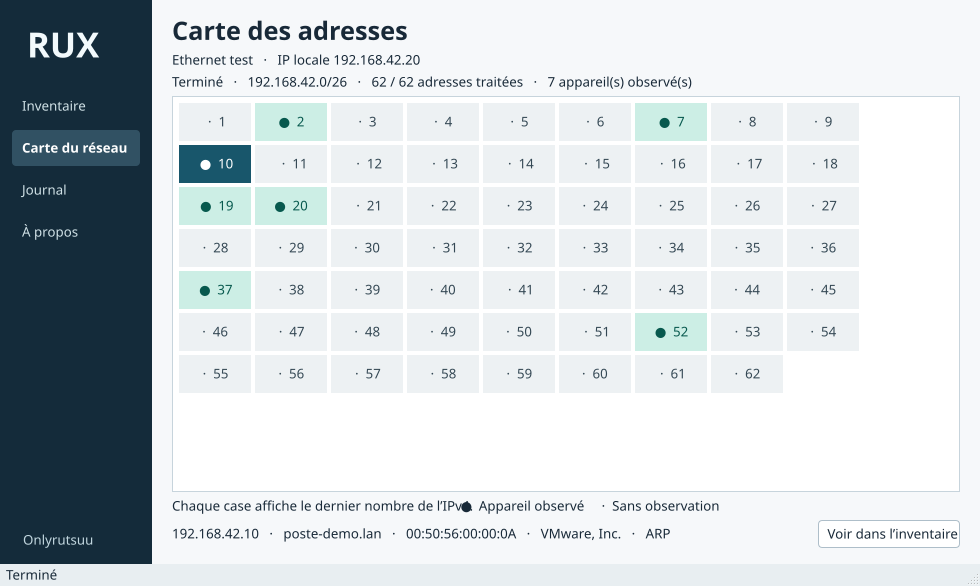
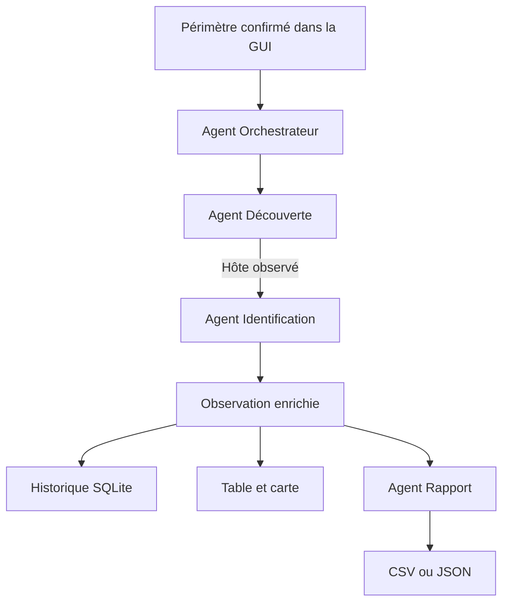

<!-- RUX NetMap · Onlyrutsuu -->
<p align="center"></p>

<p align="center">
  <strong><a href="https://github.com/RufusTheDwarf/Rux-NetMap/releases/latest/download/RUX.exe">Télécharger RUX.exe pour Windows x64</a></strong>
  &nbsp;·&nbsp; <a href="https://github.com/RufusTheDwarf/Rux-NetMap/releases/latest/download/RUX.exe.sha256">SHA-256</a>
  &nbsp;·&nbsp; <a href="https://github.com/RufusTheDwarf/Rux-NetMap/releases">Toutes les versions</a>
</p>

<p align="center">
  <a href="https://github.com/RufusTheDwarf/Rux-NetMap/releases"></a>
  <a href="https://github.com/RufusTheDwarf/Rux-NetMap/actions/workflows/windows.yml"></a>
  <a href="LICENSE"></a>
</p>

RUX montre quels appareils répondent sur ton réseau local. Choisis l’interface Ethernet ou Wi-Fi, confirme la plage IPv4, puis consulte les résultats sur une carte ou dans une table exportable. L’application fonctionne avec un compte Windows standard et embarque Python, Qt et son registre de fabricants.

<p align="center">
  <a href="#demarrage">Premier scan</a> · <a href="#carte">Carte</a> · <a href="#exports">Exports</a> · <a href="#build">Build Windows</a> · <a href="#depannage">Dépannage</a> · <a href="docs/TECHNIQUE.md">Référence technique</a>
</p>

<a id="demarrage"></a>
<h2 align="center">Démarrage // Ton premier scan</h2>

1. Sous Windows 10 ou 11 x64, télécharge **RUX.exe** en haut de cette page et ouvre-le. Le même fichier se trouve dans **Releases → Assets → RUX.exe**.
2. Dans **Inventaire**, choisis la carte reliée au réseau à inventorier. Si tu utilises une VM, vérifie le nom de la carte et son adresse IPv4.
3. Vérifie le CIDR. Par exemple, pour tester une petite partie de `192.168.1.0/24`, entre `192.168.1.0/28`. Cette tranche couvre les hôtes `.1` à `.14`.
4. Clique sur **Lancer le scan**. Le dialogue indique l’interface, la plage, le délai et les méthodes. Confirme uniquement si tu es autorisé à inventorier ce réseau.
5. Suis la progression dans **Inventaire** ou **Carte du réseau**. **Annuler** conserve les observations déjà obtenues. **Journal** donne le détail d’un résultat partiel.

<a id="carte"></a>
<h2 align="center">Carte // Retrouver un appareil</h2>

Chaque case représente une adresse de la plage confirmée. Le nombre affiché est le dernier octet de l’IPv4. Un point plein indique une réponse ou la présence du poste local. Une case sans observation peut appartenir à un appareil silencieux ou à une adresse que le scan n’a pas encore traitée.

Sélectionne une case pour lire l’IP complète et les informations disponibles. **Voir dans l’inventaire** sélectionne l’appareil dans la table, même si un filtre le masquait. Ouvrir la carte ne déclenche aucune requête réseau supplémentaire.

<p align="center"></p>
<p align="center"><em>Interface réelle de RUX 1.1.0 avec les données d’un réseau de démonstration.</em></p>

<a id="exports"></a>
<h2 align="center">Inventaire // Lire et exporter les résultats</h2>

| Information | Comment RUX l’obtient |
| :--- | :--- |
| IP, méthode, MAC | Le poste local est identifié directement. Pour les autres cibles, RUX essaie ARP puis ICMP. La MAC apparaît si elle est disponible. |
| Nom DNS, fabricant présumé | Cache DNS ou requête PTR vers un serveur éligible de la plage. Recherche du préfixe MAC dans le registre OUI embarqué. |
| Premier vu, dernier vu | L’historique SQLite associe la MAC au réseau. Une observation sans MAC reste propre au scan courant. |
| Ports TCP | Seulement si l’option est cochée. RUX tente une connexion aux ports 80 et 443 des hôtes observés. Un délai expiré est affiché comme indéterminé. |

Clique sur un en-tête pour trier ou saisis une IP, un nom ou une MAC pour filtrer la table. **Exporter** enregistre toutes les observations du scan courant. Le **CSV** contient une ligne de résumé et une ligne par appareil, en UTF-8 avec séparateur point-virgule. Le **JSON** conserve les paramètres du scan et les états de chaque port testé. L’interface affiche l’heure locale et les exports utilisent UTC.

<details>
<summary>Voir un exemple de ligne du tableau JSON devices</summary>

```json
{
  "ip": "192.168.42.10",
  "mac": "00:50:56:00:00:0A",
  "hostname": "poste-demo.lan",
  "vendor": "VMware, Inc.",
  "method": "ARP",
  "latency_ms": null,
  "first_seen": "2026-11-24T09:00:00.000Z",
  "last_seen": "2026-11-24T09:04:12.240Z",
  "ports": []
}
```

Cet exemple correspond à un scan avec le contrôle TCP désactivé. Le document complet contient aussi `schema_version`, `application` et `scan`.

</details>

<h2 align="center">Périmètre // Réseau et données locales</h2>

| Réglage | Comportement |
| :--- | :--- |
| Adresses acceptées | Sous-réseaux de `10.0.0.0/8`, `172.16.0.0/12` ou `192.168.0.0/16` directement connectés à la carte choisie. Une route passant par une passerelle est refusée. |
| Taille et concurrence | 256 adresses au maximum dans le CIDR, huit tâches simultanées au maximum. Les préfixes `/31` et `/32` sont pris en charge. |
| Options initiales | DNS local activé, TCP désactivé. Délai ICMP, TCP et DNS de 650 ms, réglable de 100 à 3 000 ms. Windows gère le délai ARP. |
| Historique et logs | `%LOCALAPPDATA%\RUX\inventory.sqlite3` et `%LOCALAPPDATA%\RUX\rux.log`. Rotation du journal à 1 Mio avec trois archives. |

La veille, un pare-feu, l’isolation Wi-Fi ou la séparation en VLAN peuvent masquer des appareils. Un proxy ARP peut répondre pour plusieurs IP. La carte représente les adresses observées sur le segment. Le câblage physique et les liens entre commutateurs restent inconnus.

<a id="build"></a>
<h2 align="center">Développement // Tester et construire RUX.exe</h2>

Pour utiliser la version distribuée, le téléchargement de l’exécutable suffit. Pour modifier le projet, prépare **Git** et **Python 3.12 x64** sous Windows. Le projet accepte Python 3.11 à 3.14.

```powershell
git clone https://github.com/RufusTheDwarf/Rux-NetMap.git
cd Rux-NetMap
py -3.12 -m venv .venv
.\.venv\Scripts\python.exe -m pip install ".[build]"
.\.venv\Scripts\python.exe main.py
```

Lance ensuite les tests seuls ou le build complet dans PowerShell.

```powershell
.\.venv\Scripts\python.exe -m unittest discover -s tests -v
.\Build-RUX.cmd
```

| Fichier produit | Contenu |
| :--- | :--- |
| `dist\RUX.exe` | Application x64 autonome empaquetée par PyInstaller. |
| `dist\RUX.exe.sha256` | Empreinte du binaire généré. |
| `.pyi-work\self-test.json` | Rapport de démarrage du binaire, versions Qt et Python, interfaces et registre OUI. |

Le [workflow Windows](.github/workflows/windows.yml) exécute le même build dans GitHub Actions. Il lance l’interface empaquetée, vérifie la ressource de version Windows et conserve les résultats dans l’artefact **RUX-Windows-x64**. Le code de la version 1.1.0 a passé 47 tests sur Windows Server 2022 x64. Les tests de découverte utilisent un réseau simulé et le test Windows énumère les interfaces du runner.

<details>
<summary>Vérifier le fichier téléchargé ou lancer son auto-test</summary>

Télécharge `RUX.exe` et `RUX.exe.sha256` de la même release dans un dossier où ton compte peut écrire. Ouvre PowerShell dans ce dossier.

```powershell
$attendu = ((Get-Content .\RUX.exe.sha256 -Raw).Trim() -split '\s+')[0]
(Get-FileHash .\RUX.exe -Algorithm SHA256).Hash -eq $attendu
(Get-Item .\RUX.exe).VersionInfo | Select-Object CompanyName, ProductVersion
$p = Start-Process .\RUX.exe -ArgumentList '--self-test','rux-verification.json' -Wait -PassThru
$p.ExitCode
Get-Content .\rux-verification.json
```

La comparaison doit afficher `True`, l’auteur indiqué est **Onlyrutsuu**, et l’auto-test doit finir avec le code `0` et `"ok": true`. Le binaire publié est distribué sans certificat Authenticode.

</details>

<h2 align="center">Architecture // Du scan à la carte</h2>

Les quatre agents sont des modules Python locaux. PySide6 fournit les vues et les signaux entre le moteur et l’interface. PyInstaller regroupe le programme, Qt et le registre OUI dans un exécutable.



| Dossier | Rôle |
| :--- | :--- |
| [agents/](agents/) · [skills/](skills/) | Cycle de scan, découverte, enrichissement, exports et journalisation. |
| [core/](core/) | Périmètre et consentement, appels Windows, modèles, configuration et historique. |
| [gui/](gui/) | Inventaire, carte IPv4, confirmation, journal et écran À propos. |
| [data/](data/) · [build/](build/) | Registre OUI et notices, icône, configuration PyInstaller et métadonnées Windows. |
| [tests/](tests/) | Tests des agents, des skills, de l’interface, du stockage et des API Windows. |

Les entrées, sorties et erreurs de chaque skill sont documentées dans la [référence technique](docs/TECHNIQUE.md).

<a id="depannage"></a>
<h2 align="center">Dépannage // Les cas courants</h2>

| Ce que tu vois | Quoi vérifier |
| :--- | :--- |
| Du Python ou un ZIP « Source code » | Ouvre [la dernière release](https://github.com/RufusTheDwarf/Rux-NetMap/releases/latest), déplie **Assets** et choisis **RUX.exe**. |
| « Aucune interface IPv4 privée active » | Connecte la carte Ethernet ou Wi-Fi voulue, vérifie son IPv4 avec `ipconfig` et clique sur **Actualiser**. |
| Une plage refusée | Utilise l’adresse réseau exacte du CIDR, sur le segment de l’interface. Pour un grand LAN, choisis un `/24` ou une tranche plus petite. |
| Peu d’appareils ou des fabricants inconnus | Consulte **Journal**. Un hôte peut être en veille ou isolé. Une MAC aléatoire ou un préfixe inconnu peut laisser le fabricant vide. |
| Un scan annulé ou partiel | Le journal précise la cause. Les appareils déjà observés restent consultables dans la carte et exportables. |

Pour d’autres besoins d’inventaire sur un réseau autorisé, [Nmap](https://nmap.org/book/man.html) propose davantage de méthodes et [arp-scan](https://github.com/royhills/arp-scan) se concentre sur la découverte ARP locale.

<h2 align="center">Crédits // Code et dépendances</h2>

**Onlyrutsuu** est l’auteur de RUX. Le code du projet est distribué sous [licence MIT](LICENSE). Les conditions du registre OUI et des composants embarqués figurent dans les [notices des tiers](data/NOTICE.txt).

<p align="center"></p>
